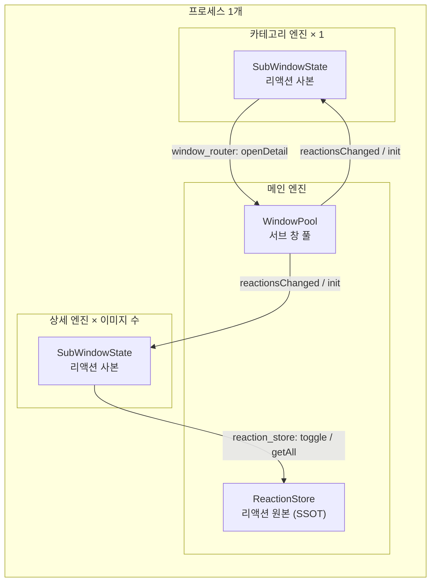

# Flutter Desktop Multi-Window Sample

Flutter Desktop(Windows·macOS)에서 창을 여러 개 띄우면 내부에서 무슨 일이 일어나는지 보여 주는 샘플앱이다.
[`desktop_multi_window`](https://pub.dev/packages/desktop_multi_window)는 **프로세스 1개 안에서 창마다 Flutter 엔진을
하나씩** 띄운다. 이 구조 때문에 생기는 제약과 그 대처법을 코드와 로그로 확인할 수 있게 만들었다.

기능은 단순한 이미지 뷰어다. 이미지에 리액션(❤️ 👍 👎 😂 😮)을 붙이고, 리액션별로 이미지를 모아 본다.

| 창 | 하는 일 |
| --- | --- |
| 메인 | 이미지 그리드, 이미지별 리액션 배지, 우측 상단에 리액션별 개수. 이미지 클릭 → 상세 창, 우클릭 → 리액션 토글, 개수 클릭 → 카테고리 창 |
| 상세 (이미지마다 1개) | 이미지를 크게 보기. 우클릭 메뉴로 리액션 토글, 하단에 붙은 리액션 표시 |
| 카테고리 (1개 재사용) | 한 리액션이 붙은 이미지만 모아 보기. 이미지 클릭 → 상세 창 |

어느 창에서 리액션을 바꾸든 모든 창이 바로 갱신된다. 데이터는 메모리에만 있고 앱을 끄면 초기화된다.

## 핵심 설계 포인트

1. **창 하나 = 엔진 하나.** 엔진마다 `main()`이 처음부터 다시 실행되고, Dart 힙도 따로다.
2. **상태는 한 엔진만 소유한다.** 전역 변수도 싱글턴도 창끼리 공유되지 않는다. 메인이 원본을 갖고, 서브는 채널로 요청하고 push를 받는다.
3. **창은 닫지 말고 숨긴다.** 엔진을 새로 띄우는 비용이 크니 X는 hide로 바꾸고 다시 열 때 재사용한다.
4. **플러그인은 엔진마다 다시 등록해야 한다.** 네이티브 러너에 서브 엔진 생성 콜백이 필요하다.
5. **위젯 교체 순서가 1개짜리 리스너를 덮어쓴다.** 새 위젯 `initState`가 옛 위젯 `dispose`보다 먼저 실행된다.



## 동작 원리

### 1. 창 하나 = 엔진 하나

`WindowController.create()`를 부를 때마다 네이티브 쪽에서 엔진이 하나 새로 뜨고, 그 엔진이 같은 `main()`을 실행한다.
그래서 `main()`은 "지금 어떤 창인가"부터 판별해야 한다.

- 메인 창은 `WindowController.fromCurrentEngine().arguments`가 빈 문자열이다.
- 서브 창은 만들 때 `arguments`에 JSON을 넣는다: `{"type":"detail","imageId":"assets/images/sunset.jpg"}`,
  `{"type":"category","reaction":"heart"}`. 생성 시에는 메인 창 중심 좌표 `anchor`(`{"x":..,"y":..}`)도 함께 넣는다.

→ `lib/main.dart` `main()`, `lib/common/channels.dart` `WindowArgs`

### 2. 상태는 메인만 소유한다

리액션 원본은 메인 엔진의 `ReactionStore`에만 있다. 서브 창은 사본을 받아 그리기만 하고, 바꾸고 싶으면 메인에 요청한다.
서브에서 토글해도 로컬 사본은 고치지 않는다. 메인이 바꾼 뒤 push해 줄 때 갱신된다.

| 채널 | 등록하는 쪽 | 모드 | 호출하는 쪽 | 메서드 |
| --- | --- | --- | --- | --- |
| `reaction_store` | 메인 | unidirectional | 서브 | `getAll`, `toggle` |
| `window_router` | 메인 | unidirectional | 서브 | `openDetail`, `windowHidden` |
| 각 서브 창의 `WindowController` 채널 | 서브 | 패키지 기본 | 메인 | `init`, `moveToScreen`, `reactionsChanged`, `shutdown` |

- 엔진 경계를 넘는 값은 `Map`·`List`·`String`뿐이다. 객체는 `toJson()`으로 보내고, 받는 쪽에서
  `Map<String, dynamic>.from(...)`으로 바꾼 뒤 `fromJson()`한다.
- 채널 핸들러는 창마다 시작할 때 한 곳에서 한 번만 등록한다.
- 서브 창을 여는 일도 메인이 한다. 카테고리 창에서 이미지를 누르면 `window_router.openDetail`로 메인에 요청한다.

→ `main_window/reaction_store.dart` `ReactionStore.serve`, `main_window/window_pool.dart` `pushToAll`

### 3. 창은 닫지 말고 숨기는 전략

| 창 | 생성 | X를 누르면 | 다시 열면 |
| --- | --- | --- | --- |
| 상세 | 이미지별 최초 1회 | 숨긴다 | 숨겨 둔 창을 `show()` |
| 카테고리 | 최초 1회 | 숨긴다 | `init`으로 리액션만 바꾸고 `show()` |
| 메인 | 러너가 생성 | 앱 전체 종료 | - |

- 서브 창은 `hiddenAtLaunch: true`로 숨긴 채 만들고, 첫 프레임이 그려진 뒤 스스로 `show()`한다. 빈 창이 먼저 보이지 않는다.
- X를 숨김으로 바꾸려면 window_manager의 `setPreventClose(true)`를 켜고 `onWindowClose`에서 `hide()`를 부른다.
  이 경로는 네이티브(X) → Dart → 네이티브(hide)를 한 번 왕복한다.

- 서브 창은 메인 창이 있는 모니터 가운데에 뜬다. `windowManager.center()`는 마우스 커서가 있는 모니터 기준이라 쓰지 않는다.
  - 생성: 메인이 자기 창 중심을 `anchor`로 넘기고, 서브가 screen_retriever로 그 점을 포함한 모니터의 작업 영역을 찾아
    가운데로 옮긴 뒤 보여 준다.
  - 재사용: 메인이 `show()` 전에 `moveToScreen`을 보낸다. 서브가 이미 메인 모니터에 있으면 사용자가 둔 위치를 유지하고,
    다른 모니터에 있을 때만 메인 모니터 가운데로 옮긴다.
  - window_manager·screen_retriever 모두 주 모니터 좌상단 기준 논리 좌표를 쓰므로 플러그인 수정 없이 Dart에서 처리한다.

→ `sub_window/sub_bootstrap.dart` `_CloseToHide`, `showAfterFirstFrame`, `main_window/window_pool.dart` `_reshow`,
`sub_window/window_placement.dart` `moveToScreenOf`

### 4. 플러그인은 엔진마다 다시 등록한다

플러그인 채널은 엔진에 붙는다. 러너가 메인 엔진에만 플러그인을 등록하므로, 서브 엔진이 생길 때마다 다시 등록하는 콜백이
필요하다. 이 샘플은 `desktop_multi_window` README 방식대로 플러그인 전체를 등록한다. 그래서 각 창의 window_manager는
자기 창만 제어한다.

- Windows: `windows/runner/flutter_window.cpp`의 `DesktopMultiWindowSetWindowCreatedCallback` → `RegisterPlugins`
- macOS: `macos/Runner/MainFlutterWindow.swift`의 `FlutterMultiWindowPlugin.setOnWindowCreatedCallback` →
  `RegisterGeneratedPlugins`

### 5. 위젯 교체 순서와 1개짜리 리스너 슬롯

메인 그리드는 "마지막으로 반응한 이미지"에 강조 위젯을 붙인다. 강조 위젯은 `initState`에서 1개짜리 리스너 슬롯에
자기를 등록하고 `dispose`에서 해제한다. 리액션이 오면 슬롯이 이 리스너를 불러 이모지 펄스를 그린다.

다른 이미지에 리액션이 붙으면 강조 위젯이 옛 타일에서 새 타일로 옮겨 간다. 같은 위젯이 이동하는 것이 아니라 옛 타일의
위젯은 사라지고 새 타일에 새 위젯이 생긴다. 이때 실행 순서는 다음과 같다.

1. build 중 옛 위젯은 비활성 목록에 들어가기만 하고, 새 위젯은 바로 `initState`가 실행된다 → 슬롯에 등록.
2. build가 끝난 뒤(`finalizeTree`) 비활성 위젯을 한꺼번에 정리하면서 옛 위젯 `dispose`가 실행된다 → 슬롯 해제.

옛 위젯을 바로 버리지 않는 이유는 같은 프레임에서 GlobalKey로 다른 위치에 다시 붙을 수 있기 때문이다. 그래서
**새 위젯 `initState`가 항상 옛 위젯 `dispose`보다 먼저** 실행된다. 해제가 슬롯을 무조건 비우면 방금 등록한 새 리스너가
지워진다. 이를 막기 위해 등록할 때 주인(State)을 기록하고, 해제할 때 **"내 것일 때만 비우는"** 가드를 둔다.
리액션 알림은 `addPostFrameCallback`으로 프레임 뒤에 보낸다. 교체가 끝난 다음에 새 위젯이 받게 하기 위해서다.

`SLOT_GUARD=false`로 실행하면 가드 없이 리스너가 지워진다. 예외나 크래시는 나지 않는다.
**강조가 다른 이미지로 옮겨 간 뒤부터 펄스만 조용히 나오지 않는다.** 같은 이미지에 다시 리액션해도 다시 등록하는 위젯이
없으므로 계속 나오지 않는다. 로그에서 `warning! erased`와 `notify lastReacted -> EMPTY`로 확인할 수 있다.

**리스너를 여러 개 받는 구조라면 이 가드는 필요 없다.** `ChangeNotifier.addListener/removeListener`처럼 add/remove
방식이면 각 위젯이 자기 항목만 지우므로 실행 순서와 상관없이 결과가 같다. 직접 설계하는 API라면 이쪽을 쓰면 된다.
가드가 필요한 곳은 **리스너를 하나만 받고 바꿀 수 없는 API**다. `MethodChannel.setMethodCallHandler`,
`FlutterError.onError`, 네이티브 SDK의 `setDelegate`·`setCallback` 계열이 그렇다. `dispose`에서 `null`로 비우면 같은
문제가 생긴다. 이 샘플의 `ListenerSlot`은 그런 API를 단순하게 옮겨 놓은 모델이다.

→ `main_window/listener_slot.dart` `ListenerSlot`, `main_window/main_app.dart` `_LastReactedHighlightState`,
`main_window/reaction_store.dart` `toggle`

### 6. 종료

메인 창을 닫으면 숨겨 둔 서브 창이 있어도 프로세스가 남지 않아야 한다. 메인은 X를 막아 두었다가 다음 순서로 종료한다.

1. 각 서브 창에 `shutdown`을 보낸다.
2. 서브 창은 응답한 뒤 스스로 `close()`한다.
3. 메인이 `windowManager.destroy()`로 앱을 끝낸다.

→ `main_window/main_app.dart` `_QuitOnMainClose`, `main_window/window_pool.dart` `shutdownAll`


## 체크 포인트

### Windows: Flutter 3.47.0부터 Impeller가 기본 렌더러가 되어 서브 창 생성 중 메인 UI가 멈춘다

Flutter 3.47.0부터 Windows의 기본 렌더러가 Skia에서 Impeller(OpenGLES)로 바뀌었다. Impeller에서는 서브 엔진 하나를
만드는 데 2초 넘게 걸린다. 그동안 **서브 창은 늦게 뜨고, 메인 창 UI도 통째로 멈춘다**. release 빌드에서도 똑같다.

| 렌더러 | `WindowController.create` | 메인 UI 정지 |
| --- | --- | --- |
| Impeller (3.47.0+ 기본값) | 약 2200ms | 약 2200ms |
| Skia | 10~15ms | 없음 |

(release, `REUSE_WINDOWS=false`로 상세 창을 열 때 측정)

메인까지 멈추는 이유는 다음과 같다.

1. 메인 엔진은 기본 스레드 정책이라 UI 스레드가 플랫폼 스레드와 합쳐져 있다.
2. `desktop_multi_window`는 `createWindow` 채널 핸들러 안에서, 즉 플랫폼 스레드에서 서브 창의 `FlutterViewController`를
   **동기로** 만든다.
3. 이 생성자는 서브 엔진의 렌더링 준비가 끝나야 돌아오는데, Impeller는 여기서 2초 넘게 걸린다. 그동안 메인의 Dart 코드와
   프레임 처리가 모두 멈춘다.

서브 엔진의 `RunOnSeparateThread`는 서브 자신의 UI 스레드만 분리할 뿐이라 도움이 되지 않고, Dart 코드로도 피할 수 없다.
창 재사용(3번)을 켜 두면 각 창을 처음 열 때만 비용이 들지만, 그 한 번도 메인이 2초 넘게 멈춘다.

해결 방법은 둘 중 하나다.

- **Flutter를 3.44.x 이하로 내린다.** Skia가 기본값이던 마지막 stable 계열이다. 단, 3.44 이하에는 아래의
  `set_impeller_switch` API가 없다.
- **`desktop_multi_window`를 vendoring해서 렌더러를 Skia로 고정한다.** 서브 엔진의 `DartProject`는 플러그인 안에서
  만들어지고, release 빌드에서는 환경변수로 엔진 스위치를 넘길 수 없다. 그래서 플러그인 코드를 가져와 직접 고쳐야 한다.

### macOS: pub.dev의 window_manager로는 닫은 서브 창의 엔진이 해제되지 않는다

window_manager pub.dev 최신 버전(0.5.2)은 자기 창을 강한 참조로 들고 있다. 서브 엔진에 등록된 window_manager가 서브 창을
잡고, 창이 엔진을 잡고, 엔진이 다시 플러그인을 잡으면서 순환 참조가 생긴다. 그래서 창을 실제로 닫아도 창과 엔진이 둘 다
남는다.

```
NSWindow → FlutterViewController → FlutterEngine → WindowManagerPlugin → WindowManager ─(강한 참조)─┐
   ↑                                                                                                │
   └────────────────────────────────────────────────────────────────────────────────────────────────┘
```

`desktop_multi_window` README가 권하는 window_manager 포크는 이 참조를 `weak`로 바꾼 한 줄 수정이 들어 있다.
이 샘플은 그 포크를 고정 커밋으로 쓴다 (`pubspec.yaml`).

```yaml
window_manager:
  git:
    url: https://github.com/boyan01/window_manager.git
    path: packages/window_manager
    ref: 6fae92d21b4c80ce1b8f71c1190d7970cf722bd4   # "fix macos window leak"
```

### `windowManager.destroy()`는 앱 전체를 끝낸다

window_manager의 `destroy()`는 macOS에서 `NSApp.terminate`, Windows에서 `PostQuitMessage`다. 서브 창에서 부르면 다른 창까지
모두 사라진다. 서브 창은 `close()`로 자기 창만 닫고, `destroy()`는 메인 종료에만 쓴다.

## 사용 패키지

| 패키지 | 버전 | 비고 |
| --- | --- | --- |
| [`desktop_multi_window`](https://pub.dev/packages/desktop_multi_window) | 0.3.1 | pub.dev 원본 |
| [`window_manager`](https://github.com/boyan01/window_manager) | 0.5.1 + 누수 수정 | 포크 고정 커밋 ([체크 포인트](#체크-포인트) 참고) |
| [`screen_retriever`](https://pub.dev/packages/screen_retriever) | ^0.2.2 | window_manager 의존성. 모니터 작업 영역 조회 |


